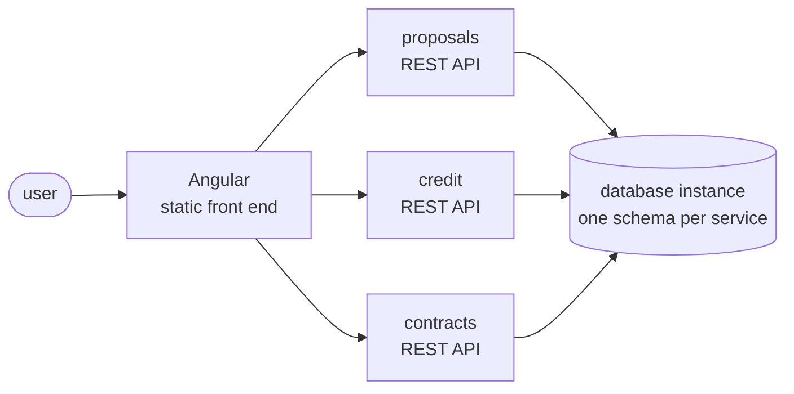

# spec-hermes

> Hermes, the Greek god of trade and messengers, crossed every border carrying messages.

**Hermes** is a demo of an equipment financing process: a farmer asks for credit to buy a tractor, the proposal and its documents are read, the credit is analyzed, and if the answer is yes a contract is issued and the money goes to the dealer.

Its architecture follows the way I worked at WM Trading, a foreign trade company, in 2023–2024 (sections 1.2 and 1.3 of my [portfolio](https://batchuka.github.io/)): one independent service per business domain, each with its own code, its own deploy and its own data, and one front end that serves all of them. The services are built first and on their own. How they are connected into one process comes later, when the business asks for it. The original ran import processes; this one runs financing, small enough to read in an afternoon and cheap enough to run on AWS for an hour.

This hub holds the book, the decisions and the workflow.

## Repositories

| Repository | Role | Stack |
| --- | --- | --- |
| [`hermes-orchestrator`](https://github.com/Batchuka/hermes-orchestrator) | the master: runs the route of each proposal | Spring Boot, MySQL, EventBridge, SQS |
| [`hermes-proposals`](https://github.com/Batchuka/hermes-proposals) | proposals and their documents | Spring Boot, MongoDB |
| [`hermes-credit`](https://github.com/Batchuka/hermes-credit) | credit analysis: score, limit, suggested decision | Spring Boot, MySQL |
| [`hermes-contracts`](https://github.com/Batchuka/hermes-contracts) | contract, installments (Price or SAC), disbursement | Spring Boot, MySQL |
| [`hermes-web`](https://github.com/Batchuka/hermes-web) | the screen | Angular, Keycloak login |
| [`hermes-infra`](https://github.com/Batchuka/hermes-infra) | local stack and the AWS environment | Docker Compose, LocalStack, Keycloak, Terraform |
| [`spec-hermes`](https://github.com/Batchuka/spec-hermes) | this hub: book, ADRs, practice, workflow | LaTeX, Markdown |

Issues live in each repository and on the [Hermes project](https://github.com/users/Batchuka/projects/13). How I work is in [`WORKFLOW.md`](WORKFLOW.md).

## Architecture

Decisions are in [`docs/adr/`](docs/adr/). The starting point is [ADR 0001](docs/adr/0001-architecture.md): three independent services, one per business domain, one front end for all of them, and one schema per service in a single database instance.

The services do not know each other. The layer that connects them into one process (the orchestrator and the buses) is a later decision. It will be recorded in its own ADR and explained in the book.

## Book and practice

- [`book/`](book/): why the technologies in this project are the way they are. Every chapter ends with interview questions answered out loud.
- [`practice/english/`](practice/english/): one English practice kit per chapter.
- [`practice/hackerrank/`](practice/hackerrank/): typical coding exercises, each tied to a part of the code.
