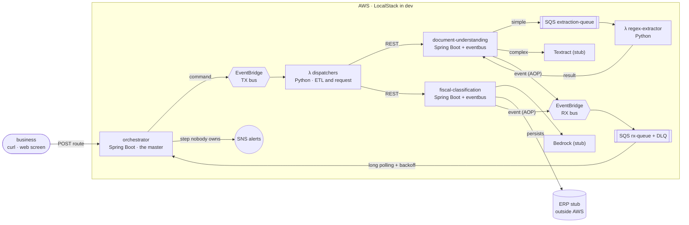

# spec-hermes

> Hermes, the Greek god of trade, travelers and messengers, crossed every border carrying messages.

A small, runnable reconstruction of two systems I designed at WM Trading, a foreign trade company, between 2023 and 2024. They are sections 1.2 and 1.3 of my [portfolio](https://batchuka.github.io/):

- **Invoice to customs classification, without e-mail (2023).** A new client (BYD) was about to multiply the number of invoices. Either we automated the manual process or the customs team had to double. Two Spring Boot microservices did it: **Document Understanding (DU)** reads the documents and **Fiscal Classification (CLF)** suggests the NCM code from the client's previous classifications.
- **Event buses and a route orchestrator (2023–2024).** The company turned that solution into a product for individual importers: 5,000 processes a day in one marketplace alone. I designed a small, AWS-only architecture modeled on an industrial fieldbus: a **TX bus** and an **RX bus** on EventBridge, a **single master** (the orchestrator) and a protocol of our own.

The real systems are private. This is a demo version, small enough to read in an afternoon, built to explain the decisions behind them.

## What I know today

- I built the original with Java/Spring Boot, Python, SQS, Lambda and EventBridge, and led four developers while doing it.
- I want to explain every decision in English, from the queue settings to why there is one master.
- Expensive or private pieces (Textract, Bedrock, the ERP) are stubs behind an interface. Everything runs locally on LocalStack; a real AWS deploy is a bonus.

This changes as I go.

## Repositories

| Repository | Role |
| --- | --- |
| [`spec-hermes`](https://github.com/Batchuka/spec-hermes) | this hub: the book, the decisions (`docs/adr/`), practice and the workflow |
| [`hermes`](https://github.com/Batchuka/hermes) | the code: a Maven monorepo with the orchestrator, the two services, the `eventbus` library, the Python Lambdas and the infrastructure |
| [`demo-event-driven`](https://github.com/Batchuka/demo-event-driven) | an earlier, HTTP-only take on the orchestrator, kept as a reference |

Issues live in each repository and on the Hermes project board. How I work is in [`WORKFLOW.md`](WORKFLOW.md).

## Architecture

Decisions are in [`docs/adr/`](docs/adr/). The overall architecture is [ADR 0001](docs/adr/0001-architecture.md).

## Book

[`book/`](book/): why the technologies in this project are the way they are. Practice exercises tied to the code are in [`practice/hackerrank/`](practice/hackerrank/).
