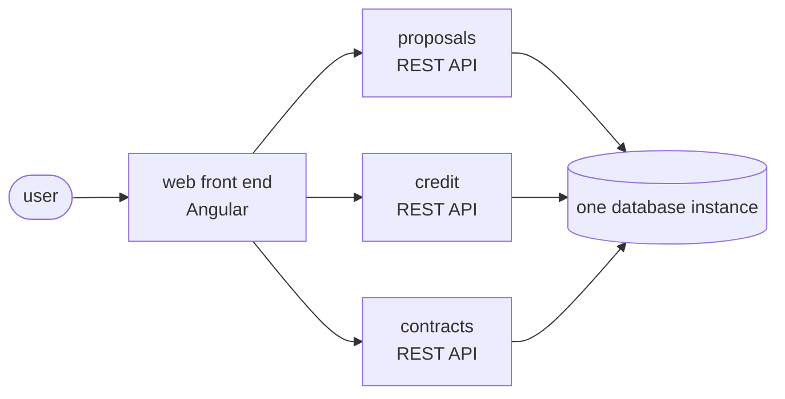

# 0001. Independent services, one per business domain

Status: accepted, amended by [0002](0002-database-per-service.md) (one database per service, not one instance) · Issue: #1

## Context

Hermes runs an equipment financing process. A farmer asks for credit to buy a tractor. The proposal arrives with documents, the credit is analyzed, and if the answer is yes a contract is issued, the installments are scheduled and the money goes to the dealer.

The business has clear domains, and each one has its own rules and its own data:

- **proposals**: the request for credit and its documents.
- **credit**: the score, the limit and the decision.
- **contracts**: the contract, the installments and the disbursement. It handles money, so it needs transactions.

This is how I worked at WM Trading in 2023–2024. The business rules of each domain were closed, so each application could be modeled on its own and still fit the others.

What we need:

- Each domain can change, be tested and be deployed without touching the others.
- Each domain owns its data, and nobody else reads it.
- The people who use the system see one screen, not three.
- AWS only, managed services, and cheap enough to run for a demo.

## Decision

We build **three independent services, one per domain, and one web front end that serves all of them.** There is no monolith.

- **One service per domain.** Each one is its own application, with its own repository, its own build and its own deploy. Each exposes a REST API.
- **One front end for all.** A static Angular app, served from a CDN, that calls the APIs. Nothing is rendered on the server (a Jamstack style).
- **One schema per service, in a single database instance.** Each service creates and migrates only its own schema, and never queries another one. One instance keeps the demo cheap, and the schemas can move to separate instances later without changing any service.
- **The services do not know about each other.** If a business rule needs data from another domain, we decide how to get it when the need appears, and record it in a new ADR.

This ADR does not choose how the services will be connected into one process. That comes later, when the business asks for it.

## Alternatives

- **A monolith.** One application and one database. It is the simplest to start, but every domain would change and deploy together, and the boundaries would erode over time.
- **A shared database with shared tables.** Services would be coupled through the tables, and a change in one would break the others.
- **One front end per service.** Users would move between three screens. We keep one, because the users work across the domains.

## Consequences

- A domain can change, scale and deploy alone.
- The boundaries are explicit: the only way into a domain is its API.
- There are more things to run than in a monolith: three services, one front end, one database instance.
- A process that crosses domains, such as "approve the credit and then issue the contract", is not solved here. It will need its own decision.
- Cross-domain data cannot be joined in SQL. That is a price of the boundaries.

## How I say it

> I designed this system around the business domains. A farmer asks for credit to buy a tractor, and the work is split in three: proposals, credit and contracts. Each one is its own service, with its own code, its own deploy and its own schema in the database, so it's not a monolith. One Angular front end serves the three of them. I did the same thing at my last company: the business rules were clear, so each application could be built alone, and they fit together later. I kept the question of how they talk to each other for a later decision, because it should come from what the business needs.

## Words

| Word | Meaning here |
| --- | --- |
| domain | an area of the business with its own rules and its own data |
| monolith | one application that holds all the domains |
| microservice | a small application that owns one domain |
| schema | a named set of tables inside a database instance |
| Jamstack | a static front end that calls APIs, with no server-side rendering |
| boundary | the line a domain does not cross: only its API goes out |
