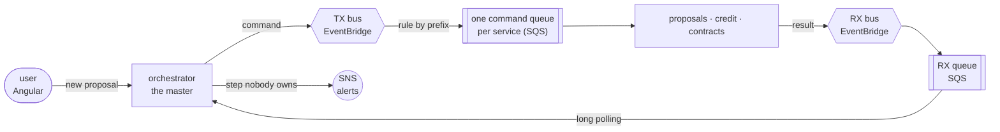

# 0001. One master over two event buses

Status: accepted · Issue: #1

## Context

Hermes runs an equipment financing process. A farmer asks for credit to buy a tractor. The proposal arrives with documents (the equipment invoice, proof of income), the credit is analyzed, and if the answer is yes a contract is issued, the installments are scheduled and the money goes to the dealer.

Each step belongs to a different part of the business, with its own rules and its own data:

- **proposals** owns the proposal and its documents. Each document type has a different shape.
- **credit** owns the score, the limit and the decision.
- **contracts** owns the contract, the installment schedule and the disbursement. It handles money, so it needs transactions.

What we need:

- The services must not know about each other. Adding a step must not change the services that already exist.
- The business declares the steps of each process (a **route**), and the route can change.
- Someone must always know where every proposal is, and notice a step that nobody answers.
- AWS only, managed services, and cheap enough to run for a demo.

This is the architecture I designed at WM Trading in 2023–2024 for import processes, where one marketplace alone meant 5,000 processes a day. Hermes rebuilds it on a financing process.

## Decision

We model the platform on an **industrial fieldbus**, like Profibus: one master, many slaves, a shared bus and a protocol of our own.

- **The orchestrator is the only master.** It keeps the routes and the state of every proposal. It sends one command at a time and waits for the answer.
- **TX bus:** only the master publishes on it. An EventBridge rule matches each command by its prefix (`proposals.`, `credit.`, `contracts.`) and delivers it to that service's command queue.
- **RX bus:** the services publish their results on it. A rule sends everything to one SQS queue that only the master reads.
- **Queues, not HTTP calls:** a service that is down loses nothing; the command waits in its queue. Every reader uses long polling, deletes a message only after handling it, and ignores duplicates.
- **The protocol** is a small envelope on every message: `eventId`, `correlationId` (the proposal id), `step`, `source`, `time` and the payload.
- **A step nobody owns:** if no answer comes within a timeout, the master alerts the team on SNS.
- **Data:** each service owns its database. `proposals` uses MongoDB; `credit`, `contracts` and the orchestrator use MySQL, one database each on one RDS instance.
- **Identity:** Keycloak. The Angular screen logs in with OIDC and PKCE; every service checks the JWT.

## Alternatives

- **Choreography**, where each service reacts to the events of the others. Nobody knows where a proposal is, and changing the route means changing services.
- **Direct REST calls between services.** Every service needs to know the others, and every caller needs its own retries and timeouts.
- **Step Functions.** It is also an orchestrator, and it would work. We keep the master in Spring because the route is data declared by the business, not a state machine deployed with the code.
- **Kafka (MSK).** A log is the right tool for high throughput and replay. Here it means a cluster to run and pay for, for a few events per second.

## Consequences

- A new service joins with one queue, one rule and the envelope. The other services do not change.
- There is one place to see every proposal.
- The master is a single point of failure. Its state lives in MySQL, and the queues keep the messages while it is down.
- SQS and EventBridge deliver **at least once**, so every handler must be idempotent.
- Each hop adds some latency. That is fine for a credit process that takes minutes.
- Credit approved but contract failed means undoing a step: the master runs a compensation (a saga), not a database rollback.

## How I say it

> At my last company I designed an architecture for import processes, and this project rebuilds it on a financing process. A farmer asks for credit to buy a tractor. Three services do the work: proposals, credit and contracts. They don't know about each other. A fourth service, the orchestrator, is the only master. I took the idea from industrial networks, where I come from: one master and a shared bus. The orchestrator publishes a command on a TX bus in EventBridge. A rule delivers it to the right service's queue. The service does its job and answers on an RX bus, and everything on RX goes to one SQS queue that only the orchestrator reads. So the services stay independent, nothing is lost if one of them is down, and we always know where every proposal is.

## Words

| Word | Meaning here |
| --- | --- |
| bus | a shared channel; whoever is interested listens to it |
| master | the only one allowed to start a conversation on the bus |
| route | the list of steps of a process, declared by the business |
| correlation id | the id that ties every message of one proposal together |
| at-least-once | a message may arrive more than once, but it is never lost |
| idempotent | doing it twice has the same effect as doing it once |
| saga | a long process made of local steps, each with a compensation |
| long polling | the server holds the request until a message arrives or the wait ends |
