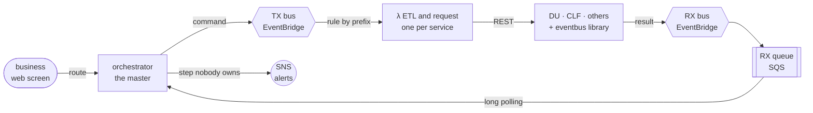

# 0001. One master over two event buses

Status: accepted · Original decision: 2023, WM Trading · Issue: #1

## Context

In 2023 we already had two Spring Boot microservices: **Document Understanding (DU)**, which reads invoices and other trade documents, and **Fiscal Classification (CLF)**, which suggests the NCM customs code for each item. They worked, but each one was isolated. A person moved every process from one system to the next.

Then the company decided to sell the same solution as a digital import product for individuals. One marketplace alone meant **5,000 processes a day**, and the number of integrations and requests per system would more than double. I had **four developers and less than three months**.

What we needed:

- The services must not know about each other. Adding a step must not change the services that already exist.
- The business declares the steps of each process (a **route**), and routes change from client to client.
- Someone must always know where every process is, including the steps that no system does yet.
- AWS only, with managed services. No cluster to operate.

## Decision

We modeled the platform on an **industrial fieldbus**, like Profibus: one master, many slaves, a shared bus and a protocol of our own.

- **The orchestrator is the only master.** It keeps the routes and the state of every process. It sends one command at a time and waits for the answer.
- **TX bus:** only the master publishes on it. An EventBridge rule matches each command by its prefix (`du.`, `clf.`) and triggers a small Python Lambda. The Lambda translates the command into the payload the service already understands and calls its REST API.
- **RX bus:** the services publish their results on it through the **eventbus library**. The library turns internal Spring events into bus events with AOP, so no business rule had to change.
- **RX queue:** a rule sends everything on the RX bus to one SQS queue. The master is its only reader. It uses long polling, backs off when SQS fails, deletes a message only after handling it, and ignores duplicates.
- **The protocol** is a small envelope on every message: `eventId`, `correlationId`, `step`, `source`, `time` and the payload.
- **A step nobody owns:** if no answer comes within a timeout, the master alerts the team on SNS.

In this demo, Textract, Bedrock and the ERP are stubs behind interfaces, and everything runs on LocalStack.

## Alternatives

- **Choreography**, where each service reacts to the events of the others. Nobody knows where a process is, and changing a route means changing services.
- **Direct REST calls between services**, as in [`demo-event-driven`](https://github.com/Batchuka/demo-event-driven). Every service needs to know the others, and every caller needs its own retries.
- **Step Functions.** It is also an orchestrator, and it would have worked. Our routes were declared by the business at run time on a web screen, and the team already knew Spring well, so we kept the master in our own code.
- **Kafka (MSK).** A cluster to operate, for an average of less than one event per second. Too much for the problem.

## Consequences

- A new service joins with the library, one rule and one Lambda. The other services do not change.
- There is one place to see every process.
- The master is a single point of failure. Its state lives in a database, and SQS keeps the messages while it is down.
- SQS and EventBridge deliver **at least once**, so every handler must be idempotent.
- Each hop adds some latency. That is fine for documents that take minutes, not milliseconds.

## How I say it

> At WM, a foreign trade company, we had two microservices that read invoices and classified the items for customs, but a person moved each process between them. When the company decided to sell this as a product, one marketplace alone meant five thousand processes a day. I had four developers and less than three months. I took the model from industrial networks, where I come from: one master and a shared bus. The orchestrator publishes commands on a TX bus in EventBridge. Small Lambdas pick them up and call the services. The services answer on an RX bus through a library we wrote, which uses AOP, so the business code didn't change. Everything on RX goes to one SQS queue that only the orchestrator reads. The services don't know about each other, and we always know where every process is.

## Words

| Word | Meaning here |
| --- | --- |
| bus | a shared channel; whoever is interested listens to it |
| master | the only one allowed to start a conversation on the bus |
| route | the list of steps of a process, declared by the business |
| correlation id | the id that ties every message of one process together |
| at-least-once | a message may arrive more than once, but it is never lost |
| visibility timeout | how long a received message stays hidden from other readers |
| idempotent | doing it twice has the same effect as doing it once |
| dead-letter queue | where a message goes after failing too many times |
| long polling | the server holds the request until a message arrives or the wait ends |
