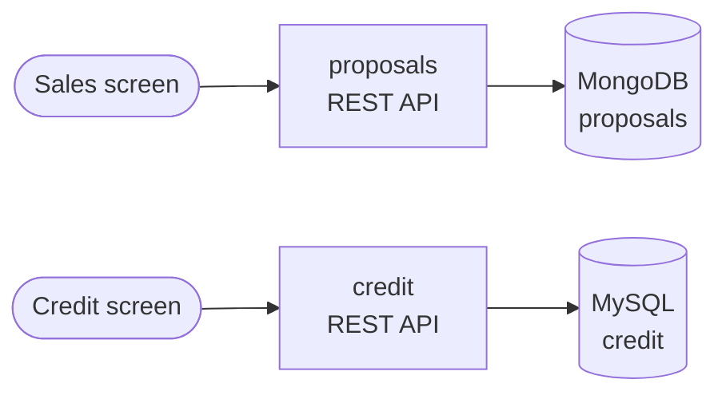

# 0002. Each service picks its own database

Status: accepted · Use case: UC-02 (#17) · Amends: [0001](0001-architecture.md)

## Context

ADR 0001 said each service owns one schema, and that all the schemas live in a single database instance. That was written before any service existed.

Then the use cases arrived, and the two services we built need different kinds of data:

- **proposals** (UC-01) stores what the dealer sends. Each dealer sends different documents, and extension 3a says a document type nobody has seen must be stored anyway, with its own fields. The shape of the data is not known in advance.
- **credit** (UC-02) stores analyses: farmer, income, amount, term, score, limit, decision and reason. The shape is fixed. The team wants a history of decisions they can query and compare.

Proposals was built on MongoDB, because a document database stores each document as it comes. Credit was built on MySQL, because its data is a table with fixed columns. Two engines cannot live in one database instance, so the code no longer matches ADR 0001.

## Decision

**Each service picks the database that fits its data, and owns it alone.**

- **proposals uses MongoDB.** A proposal and its documents are saved as one document, whatever fields the documents have.
- **credit uses MySQL.** An analysis is a row with fixed columns, easy to query and compare.
- **The rule of ADR 0001 stays:** a service never reads another service's database. The only way into a domain is its API.
- **Locally**, both run in Docker Compose (`hermes-infra/local`), one container per engine.
- Where each database runs on AWS is not decided here. That comes with the use case that puts the system on AWS (UC-14).

This ADR replaces one line of ADR 0001: "One schema per service, in a single database instance." Everything else in ADR 0001 still holds.

## Alternatives

- **MySQL for everything, with the documents in a JSON column.** One engine to run. But the fields inside the JSON are second-class: harder to validate, index and query, and the main data of proposals would live in a column that the database barely understands.
- **PostgreSQL for everything, with JSONB for the documents.** A strong option: JSONB can be indexed and queried well, and there would be one engine. We did not take it because proposals is document-first: almost all of its data is the variable part, not a side column.
- **MongoDB for everything.** Credit would lose the fixed schema that protects its history of decisions.

## Consequences

- Each service stores its data in the shape it really has. Proposals does not fight a fixed table, and credit does not lose its fixed columns.
- There are two engines to run, learn, back up and monitor, instead of one.
- Each service tests against its own engine with Testcontainers: MongoDB for proposals, MySQL for credit.
- Data from two domains cannot be joined in one query. This was already true in ADR 0001; now it is true even at the engine level.
- The next service picks its database the same way: from its data, not from what the others use.

## How I say it

> I didn't pick one database for the whole system. Each service picks the one that fits its data. Proposals receives documents from dealers, and every dealer sends different ones, so I used MongoDB: it stores each document as it comes. Credit stores analyses with fixed fields, score, limit, decision, and the team wants to query that history, so I used MySQL. My first decision said one database instance for everything, but the real data showed two different shapes, so I wrote a new decision record instead of hiding the change. The price is two engines to operate. And the rule didn't change: a service never reads another service's database, only its API.

## Words

| Word | Meaning here |
| --- | --- |
| database engine | the software that stores the data, such as MongoDB or MySQL |
| document database | a database that stores records as JSON-like documents, each with its own fields |
| relational database | a database that stores data in tables with fixed columns |
| polyglot persistence | using different database engines for different services |
| JSONB | PostgreSQL's binary JSON type, which can be indexed and queried |
| amend | to change part of an earlier decision with a new record |
