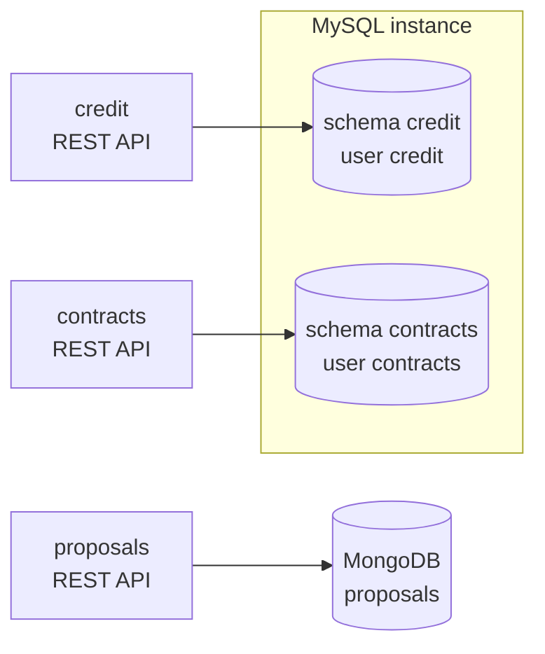

# 0003. Contracts uses MySQL, in the same instance as credit

Status: accepted · Use case: UC-03 (#35) · Applies: [0002](0002-database-per-service.md)

## Context

UC-03 adds the third service, contracts. It stores a contract with its installments: one contract, many installments, fixed columns, and a hard rule that a contract never exists without all its installments (extension 4a).

ADR 0002 says each service picks the database that fits its data, and owns it alone. It does not say each service needs its own database server. Locally we already run one MySQL container for credit (`hermes-infra/local`).

## Decision

**Contracts uses MySQL, in the instance credit already uses. It gets its own schema and its own user.**

- **MySQL fits the data.** A contract and its installments are two tables with fixed columns and a foreign key. InnoDB gives the transaction that extension 4a needs: all or nothing.
- **Same instance, separate schema and user.** The user of contracts can only see the `contracts` schema. This keeps the rule of ADR 0001: a service never reads another service's database, and the database itself enforces it, not only our habit.
- **Flyway and Testcontainers** work the same way as in credit.
- Locally, hermes-infra#4 becomes "a `contracts` schema and a user in the existing MySQL container", not a new container.

## Alternatives

- **A second MySQL container, for example on port 3307.** Isolation at the engine level: one service cannot slow the other. But it is one more thing to run, and nobody asked for that isolation yet.
- **PostgreSQL.** Also a good fit, with the same transactions. But it would be a third engine to run, learn and back up, with no benefit for this data.
- **A shared schema with prefixed tables.** Cheaper, but nothing stops one service from reading the other's tables. We rejected it.

## Consequences

- Still two engines to operate (MongoDB and MySQL), not three.
- Isolation is by schema and user, not by instance. A heavy query in credit can slow contracts, and one failed server takes both down. This is fine for a local demo and for now.
- If a use case ever asks for more isolation, for example load in Act 4, contracts moves to its own instance. Its schema, user and migrations move with it, and the code does not change except for the connection URL.
- Where the database runs on AWS is still not decided.

## How I say it

> Contracts has fixed data: a contract with its installments, and a rule that it is saved all or nothing. That is a relational problem, so I used MySQL. Credit already runs a MySQL instance, so I didn't start a second one. Contracts got its own schema and its own user, so it cannot read the credit tables, and the database enforces that, not just our convention. The price is shared resources: a heavy query in one service can slow the other. Nobody asked for more isolation yet, so I kept it simple. If load grows, moving contracts to its own instance is a small change, because it already owns its schema and its user.

## Words

| Word | Meaning here |
| --- | --- |
| instance | one running database server, which can hold many schemas |
| schema | a named set of tables inside an instance |
| transaction | a group of writes that is saved all together or not at all |
| foreign key | a column that points to a row in another table, here installment to contract |
| isolation | how much one service is protected from the others' load and data |
